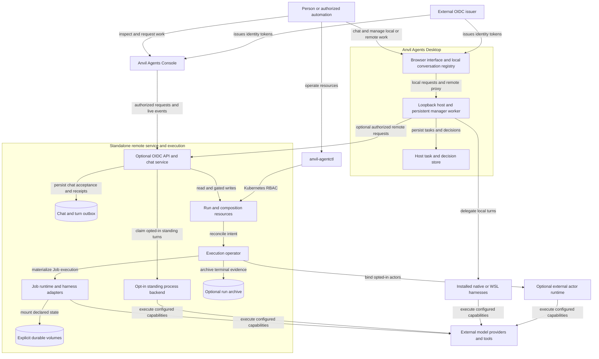

# Architecture overview

Status: **Observed** boundaries at the recorded source baseline. Dashed future
connections are intentionally omitted: this diagram describes current paths.
Runtime capability details appear in the [execution contract](../contracts/execution.md).

## Ownership and data flow

**Observed:** The controller and OIDC API are separate processes and identities.
Desktop is a client and local execution host; it does not manage cluster objects
through kubeconfig. The public runtime CLI uses Kubernetes authorization directly.

**Observed:** Remote conversational acceptance is recorded before execution via
an outbox and linked AgentRun. Job materialization records resolved payload and
child identity. InProcess turns use explicit ownership claims so the API and
controller do not both execute them. The optional actor plane has independent
enablement and capability gates.

**Observed:** Local names, settings, history and drafts originate in the Desktop
browser registry. Accepted Manager tasks and decisions live in the host store;
host snapshots can reconstruct history and expose conflicts. Direct local Chat
retains a separate browser-bound execution path. There is no replication layer
that makes those stores equivalent to remote PostgreSQL chat.

**Observed:** Persistent workspace state, conversation history, execution receipts,
and run archives are different data products. A durable home may retain native
provider state; that does not make it an Anvil conversation archive.

## Extension seams

**Proposed, operator direction:** A shared Anvil work layer links participating
conversations and artifacts across harnesses, with editable strengths describing
eligible harness/model/tool setups. The manager selects both work context and an
executor, and returns delivery/results to that shared view. This extends the
current local/remote paths; the diagram above does not depict it as implemented.
See [shared work and harness strengths](../contracts/shared-work-and-harness-strengths.md).

**Proposed:** Portable harness capability declarations, outcome verifiers, richer
workflow transitions, and addressed completion delivery belong at explicit seams
between these components. A common work identity could link their evidence while
preserving ownership. Cross-cluster dispatch needs a separate executor contract.

**Unknown:** How a future shared conversation model migrates identity, storage,
access, and recovery state between execution locations. The current architecture
does not demonstrate transparent migration or a universal warm native session.
